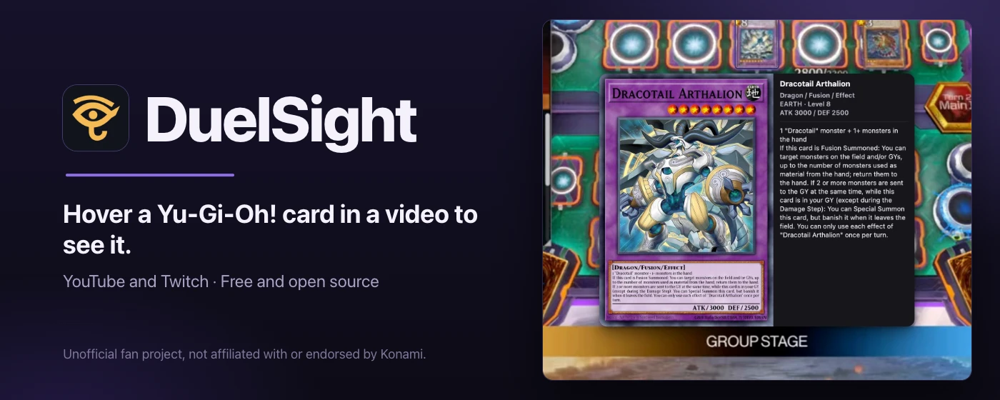

<!-- SPDX-License-Identifier: Apache-2.0 -->
# DuelSight

A Chrome extension for watching Yu-Gi-Oh! videos and streams. Hover a card in a YouTube or
Twitch video and a larger picture of it appears, with its name, type, stats and text.

The card details follow your browser's language: French, German, Italian, Spanish or Portuguese,
with the official card text where one exists. The rest of DuelSight is in English.

**DuelSight is an unofficial fan project, not affiliated with or endorsed by Konami.**
Yu-Gi-Oh!, its card names and its card art belong to their owners. Card text and images are
copyright 4K Media Inc., a subsidiary of Konami Digital Entertainment. Card data from
YGOPRODeck. Card names and texts in other languages from [Yugipedia](https://yugipedia.com), under
[CC BY-SA 4.0](https://creativecommons.org/licenses/by-sa/4.0/); those card details files are
offered under that license too.

It is aimed at Master Duel, Dueling Book and paper tables, with the camera above the table.
Master Duel and Dueling Book are measured and promised; paper is supported but not promised.
Results vary by video; see [docs/accuracy.md](docs/accuracy.md).

## Install

Install DuelSight from the [Chrome Web Store](https://chromewebstore.google.com/detail/duelsight/okngcckiafmekbmdgoakggfbicgoagnc). Then open a Yu-Gi-Oh! video on
YouTube or Twitch and rest the pointer on a card.

If your Chrome can't use the store, install from a release zip instead: see
[docs/install-from-zip.md](docs/install-from-zip.md).

## Privacy

- No accounts, analytics, telemetry or advertising.
- Video frames are never uploaded. They are analyzed inside your browser, in memory, and not
  saved.
- The extension requests one host, DuelSight's card CDN, for a small settings file, card
  pictures and a card details file, without cookies, an account ID or the address of the page
  you watch.

Details: [PRIVACY.md](PRIVACY.md) and [docs/permissions.md](docs/permissions.md).

## Documentation

| I want to… | Read |
| --- | --- |
| Turn card hovers on, update or remove the extension | [docs/using.md](docs/using.md) |
| Install from a release zip | [docs/install-from-zip.md](docs/install-from-zip.md) |
| See what it does and does not recognize | [docs/accuracy.md](docs/accuracy.md) |
| Understand how it and its settings file work | [docs/how-it-works.md](docs/how-it-works.md) |
| Build it, update the runtime, test on a local video | [docs/development.md](docs/development.md) |
| Keep it up to date, or hand it over | [MAINTAINING.md](MAINTAINING.md) |
| Submit it to the Chrome Web Store (every field, the privacy page, the store images) | [docs/store-listing.md](docs/store-listing.md) |
| Find the images uploaded to the store listings | [docs/store/README.md](docs/store/README.md) |
| Watch the promo reel, or make a new one | [docs/reel/README.md](docs/reel/README.md) |
| Make the same extension for another card game | [docs/make-it-yours.md](docs/make-it-yours.md) |

## Built on cardvision

DuelSight runs the Apache-2.0 cardvision browser runtime, vendored in
[vendor/cardvision-browser/](vendor/cardvision-browser/). The
[cardvision toolkit](https://github.com/ryangswe/riftsight-vision) holds the training and
labeling tools and the runtime's source. DuelSight began as a copy of the One Piece extension
Kenbunshoku, and keeps its Apache-2.0 license: see [NOTICE](NOTICE).

## License

Apache-2.0: [LICENSE](LICENSE), [NOTICE](NOTICE), [THIRD_PARTY_LICENSES.txt](THIRD_PARTY_LICENSES.txt)
and [release-legal/](release-legal/) for the models.
