<!-- SPDX-License-Identifier: Apache-2.0 -->

# Hover map

A map of DuelSight's hovers on the toolkit's shared hover host: what the host does for DuelSight
in a video page and in the compute frame, and DuelSight's own code around it. That is the
configuration DuelSight gives the host, the view adapter that sizes and places the tooltip frame,
the card size, the tooltip frame and what it draws, the card facts channel, the compute frame's
release choice, and the popup's choices as far as they change a hover. It anchors the files listed
under [Coverage](#coverage) and nothing else.

The shared hover host (experimental) is the toolkit's, vendored as `host-content.js` (the content
script's half) and `host-compute.js` (the compute frame's half). It follows the main video, makes
and removes the two frames, applies the site policy, gives the compute frame pictures only on the
viewer's trusted pointer (through the toolkit's capture control), reads the `enabled` and
`keepCard` switches, decides when a card is shown and when it goes, and draws the outline. The
runtime inside the compute frame, and the capture control, have their own map: the toolkit's
[hover map](https://github.com/ryangswe/riftsight-vision/blob/e452420c7d1469bfd1690b46cfcb534447050e24/docs/hover-map.md)
(`docs/hover-map.md` in the toolkit), which this page links to and does not draw again. At the commit DuelSight vendors, that map does not draw the host's own
modules yet, so the host's decisions DuelSight depends on are drawn here, from the host's source
(`browser/src/host/` in the toolkit at that commit), with the host named as their owner.

The rules are clauses of the toolkit's
[hover spec](https://github.com/ryangswe/riftsight-vision/blob/e452420c7d1469bfd1690b46cfcb534447050e24/docs/hover-spec.md),
at the commit DuelSight vendors (`vendor/cardvision-browser/cardvision-vendor.json`, toolkit
commit e452420). Where DuelSight differs from them, `HOVER-DEVIATIONS.md` says so. This page
shows the structure and the flows: which part decides what, and in what order the parts talk. It
does not repeat the rules; each element names the clauses it carries out.

**Checked by `test/hover-map.test.ts`.** Every anchor below must name a file that exists and a
symbol that file defines, every clause id must be one of the vendored spec's
(`vendor/cardvision-browser/hover-spec.json`), and every covered file must be anchored at least
once. The test checks names. It does not check behavior: a diagram can be wrong while its names
are right, so a change to a covered file, or a newly vendored host, updates this page in the same
pull request, and the reviewer reads the diagram.

## How to read it

Three layers, from the whole to the detail.

1. **Frames and messages.** Who runs where, and what they send each other.
2. **Decision points.** The questions asked between a page event and the card on screen: what a
   page gets, when the frames are made, whether a point counts, which hold a compute frame starts
   with and when keep-card makes it again, whether a card is shown (all the host's), and the
   tooltip's size and place and what it draws (DuelSight's).
3. **Flows.** Two cases as sequence diagrams, from the opening event to the card on screen.

Under each diagram a table lists its elements. Each row names an element or a part of one, the
anchors of its code, and the spec clauses it carries out.

- An anchor is `` `src/<file>.ts#<symbol>` ``. A symbol is a function, class, constant, type or
  interface, or `Class.member` for a method or an arrow-function property of that class. The view
  adapter is an object that a function returns, so its methods are anchored by their bare names:
  `` `src/content/view.ts#show` `` is the `show` of the adapter `createTooltipView` returns. A file
  with no symbol (`` `src/compute/compute.ts` ``) is a page's start-up code, which has no name.
- **The host's code is named in plain text, not anchored.** Vendored files cannot be anchors, so a
  row the host carries out names the host function and its module in the toolkit's
  `browser/src/host/` (for example `lifecycleStep`, host `lifecycle.ts`), and anchors DuelSight's
  code only where DuelSight's code takes part. The test does not check the host's names; the
  reviewer of a newly vendored host does.
- A diagram, or a node in one, that the host decides says **host** in its heading or label.
- A clause is written `S-A1` and is defined in the hover spec.
- Times and thresholds are in the spec and the code, not here.

How the diagrams are drawn, as in the toolkit's map:

- **One diagram answers one question.** A diagram that answers two is split, however small. A big
  diagram that answers one question stays whole; about 15 nodes is a prompt to check whether it
  answers two, not a limit.
- **The overview comes before the detail.** Layer 1 is the overview. Layers 2 and 3 zoom in. Each
  split follows a seam in the code: a separate policy, phase or component.
- On GitHub, a large diagram can be zoomed, or opened full screen, from the buttons that appear
  over it.

## Layer 1: the frames and their messages

DuelSight runs in three places in a video page: the content script in the page itself, and two
hidden-from-the-page extension frames inside it. The compute frame holds the toolkit's session and
its worker. The tooltip frame draws the card. In the content script, the host makes both frames,
follows the main video, decides when the card shows and draws the outline; DuelSight's view
adapter sizes and places the tooltip frame and tells it which card to draw.

### 1a. Who talks to whom

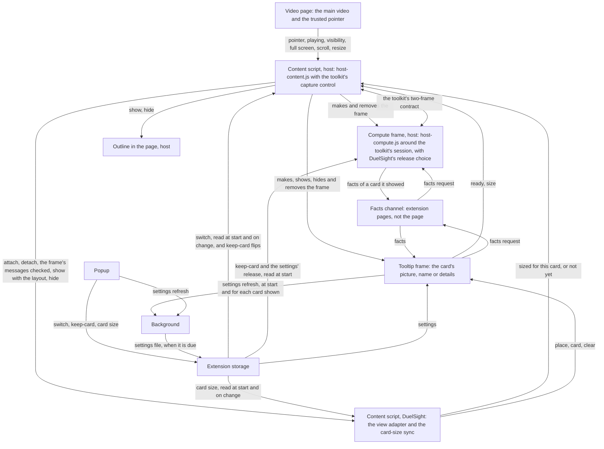

| Element | Anchors | Spec |
| --- | --- | --- |
| Content script entry: starts the host with DuelSight's configuration and view adapter, then the card-size sync | `src/content/index.ts` | |
| DuelSight's configuration, the same in both halves: the messages' tag, its name, its video sites, a dev build's local test page, the two frames' pages, the outline's colors, and no geometric stage | `src/shared/product.ts#productConfig`, `src/shared/messages.ts#TAG` | S-X2, S-A3 (a deviation: `HOVER-DEVIATIONS.md`) |
| Content script, host: follows the main video, makes and removes the frames, reads the switches, shows and hides the card and the outline (`startHostContent`, host `content.ts`) | `src/content/index.ts` | S-A1, S-A2, S-H1 |
| The capture control, and what it asks the host (the toolkit's; `eligible`, `onShown`, `whenIdle` in host `content.ts`) | | S-A4, S-A6, S-B5, S-X2 |
| The view adapter: DuelSight's side of the tooltip frame | `src/content/view.ts#createTooltipView`, `src/content/view.ts#TooltipView`, `src/content/view.ts#TOOLTIP_LOOK` | |
| A new tooltip frame, or none: everything known about the last one goes | `src/content/view.ts#attach`, `src/content/view.ts#detach`, `src/content/view.ts#forget` | |
| Messages from the tooltip frame: checked by the host (trusted, its window, the extension's origin; `fromViewFrame`, host `view.ts`), then parsed by the adapter | `src/content/view.ts#message`, `src/shared/messages.ts#parseTooltipOut` | S-B9 |
| Content script to tooltip frame: the card, numbered, or clear; one message waits for ready | `src/content/view.ts#post`, `src/content/view.ts#show`, `src/content/view.ts#hide`, `src/shared/messages.ts#TooltipIn`, `src/shared/messages.ts#tag` | |
| Tooltip frame to content script | `src/shared/messages.ts#TooltipOut`, `src/shared/messages.ts#TooltipSize` | |
| Compute frame: the host checks the page that frames it (framed, its first ancestor origin, no fallback) and starts the session with the standard options (`startHostCompute`, host `compute.ts`); DuelSight gives the release to load, its release choice and the facts channel | `src/compute/compute.ts`, `src/compute/load-request.ts#buildLoadRequest`, `src/shared/product.ts#productConfig` | S-X2, S-X3, S-B9 |
| Which pages a frame serves: both frames by the host's list (`allowedParentOrigin`, host `site-policy.ts`), the tooltip frame through host-settings.js with DuelSight's config | `src/tooltip/controller.ts#connectTooltipFrame`, `src/shared/product.ts#productConfig` | S-B9 |
| Tooltip frame: takes messages from the page that holds it, by source and origin | `src/tooltip/tooltip.ts`, `src/tooltip/controller.ts#TooltipController`, `src/tooltip/controller.ts#connectTooltipFrame` | S-B9 |
| Facts channel | `src/shared/messages.ts#FACTS_CHANNEL`, `src/shared/messages.ts#CardFactsMessage`, `src/shared/messages.ts#FactsRequest`, `src/shared/messages.ts#parseCardFacts`, `src/shared/messages.ts#parseFactsRequest`, `src/compute/frame.ts#createFactsChannel`, `src/compute/frame.ts#FactsChannel` | |
| Outline in the page: the host's (`CardOutline`, host `outline.ts`), in DuelSight's colors and marked with its tag | `src/shared/product.ts#productConfig` | S-F1 |
| Popup: the main switch, read and written under the host's key (`createSwitches`, `ENABLED_KEY`, host-settings.js) | `src/popup/view.ts#initPopup` | S-H1 |
| Popup: keep-card and card size | `src/popup/switch-control.ts#initStoredSwitch`, `src/popup/card-size-control.ts#initCardSize`, `src/shared/card-size.ts#CARD_SIZE_KEY`; keep-card read and written under the host's key (`createSwitches`, `KEEP_CARD_KEY`, host-settings.js) | S-H2 |
| Storage to the content script: the switch and keep-card read by the host under the same keys the popup writes (`createSwitches`, host `switches.ts`); the card size read by DuelSight, listening before the read so a change made while it is pending wins | `src/content/card-size-sync.ts#startCardSizeSync`, `src/shared/card-size.ts#readCardSize`, `src/shared/card-size.ts#clampCardSize`, `src/shared/card-size.ts#DEFAULT_CARD_SIZE` | S-H1, S-H3 |
| Read when the compute frame starts: keep-card, by the host; the settings' release, by DuelSight's release choice | `src/compute/compute.ts` | S-H2 |
| Settings refresh: asked by the tooltip frame and the popup, fetched by the background when due | `src/tooltip/tooltip.ts`, `src/tooltip/controller.ts#TooltipController.show`, `src/popup/popup.ts`, `src/background/index.ts` | |

Inside the compute frame, from the session core to the worker, is the toolkit's
[map, 1b](https://github.com/ryangswe/riftsight-vision/blob/e452420c7d1469bfd1690b46cfcb534447050e24/docs/hover-map.md#1b-inside-the-compute-frame).

### 1b. The life of the frames (host)

The host's lifecycle reducer (`lifecycleStep`, host `lifecycle.ts`) decides when the frames are
made and removed. It is a pure function of a phase, an event and the facts of the moment; the host
feeds it the switch, trusted `playing` events, trusted pointer events, the tab coming to the front,
the capture control's idle removal and make, keep-card flips and shown cards. Hovers start off,
and come on when the start-up read of the switch answers on or fails. A keep-card change, or full
screen, makes one frame again and keeps the other.

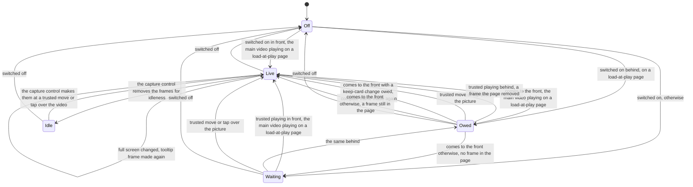

| Element | Anchors | Spec |
| --- | --- | --- |
| The phases and the reducer (`lifecycleStep`, `LifecycleState`, host `lifecycle.ts`), fed and carried out by the host (`dispatch`, host `content.ts`), which DuelSight starts | `src/content/index.ts` | S-A1, S-A2 |
| Make the missing frames: the pages DuelSight names (`makeMissing`, host `content.ts`) | `src/shared/product.ts#productConfig` | S-A1, S-A2, S-B8 |
| The handshake: the host says hello right after it appends the compute frame, once the frame's window has left its first blank page (a change from DuelSight's own code, which waited for `load`: `HOVER-DEVIATIONS.md`) | | |
| A new tooltip frame: the adapter attaches and places it at the tooltip's first size, hidden; the card on display, or held, is shown in it at once (`makeView`, `showAgain`, host `content.ts`) | `src/content/view.ts#attach`, `src/content/view.ts#show` | S-A10 |
| A frame the page removed is made again at the next trusted play on a load-at-play page or trusted move over the picture. The host also makes the tooltip frame alone again whenever it shows or places a card (a shown card, a size from the frame, the page scrolled or resized, the player resized, the card size changed), which S-A10 does not have (`showCard`, host `content.ts`) | | S-A10 |
| Idle: the capture control removes both frames, and makes them again at a trusted move over the video, connecting itself (`whenIdle`, host `content.ts`); the compute frame's idle unload is the host's standard option | `src/compute/compute.ts` | S-A4, S-A6 |
| Keep-card changed (2f) | | S-H3 |
| Full screen: a new tooltip frame inside the full-screen element, and the outline with it; the compute frame stays (`onFullscreen`, `mountHost`, host `content.ts` and `view.ts`) | `src/content/view.ts#attach` | |
| Switched off: both frames, the outline and the card go, and the video is no longer followed. Switched on: a fresh start, whatever came before (2b) | | S-H1, S-B11, S-A7 |
| Behind: a load waits for the front (owed) | | S-A7, S-A8 |

The compute frame's own life inside, from loading to idle, is the toolkit's
[map, 1c](https://github.com/ryangswe/riftsight-vision/blob/e452420c7d1469bfd1690b46cfcb534447050e24/docs/hover-map.md#1c-the-life-of-the-frames).

## Layer 2: the decision points

### 2a. What does a page get? (host)

Each page gets one of three things: nothing, hovers that load the model at the pointer, or hovers
that load it when the video plays. The host's site policy (`pagePolicy`, `ROUTES`, host
`site-policy.ts`) reads the address at each event, so in-page navigation needs no code of its own.
It looks at the site, then at the path alone, through one list of routes in order; the first that
matches wins.

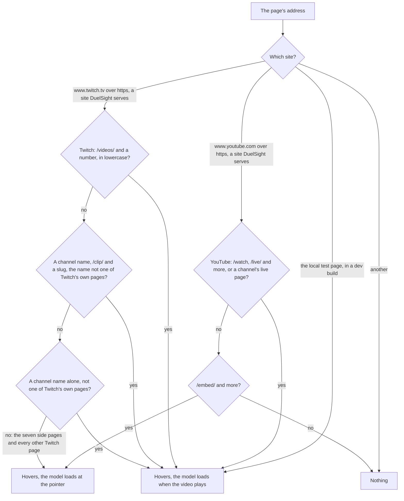

| Element | Anchors | Spec |
| --- | --- | --- |
| The sites DuelSight serves, and a dev build's local test page | `src/shared/product.ts#productConfig` | S-G1 |
| YouTube's routes: watch and live pages load at play, embeds at the pointer (`ROUTES`, host `site-policy.ts`) | | S-G1, S-G2 |
| Twitch's routes: video, clip and channel pages load at play, the rest at the pointer; Twitch's own first path parts, the seven side pages among them, are never a channel name, compared in lowercase (`ROUTES`, `TWITCH_RESERVED`, `TWITCH_SIDE_PAGES`, host `site-policy.ts`) | | S-G3 |
| Read at each event from the current address (`policyNow`, host `content.ts`) | | S-G1, S-G5 |

S-G3 is now as the spec has it. DuelSight's own address rules took `/Videos/` in any case and five
of the side pages for channel names; `HOVER-DEVIATIONS.md` lists the change.

### 2b. Do the frames load without a pointer? (host)

A trusted `playing` event, the switch turned on, or the tab coming to the front asks this. A video
that never plays loads at the pointer instead (2c). Before a trusted `playing` on a page with
hovers, the host picks the main video again, whatever video played (S-G4).

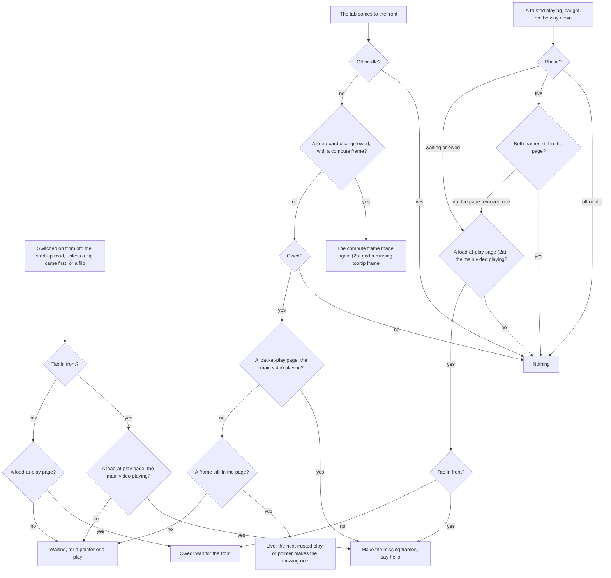

| Element | Anchors | Spec |
| --- | --- | --- |
| The `playing` event: heard on the document in the capture phase; one a page script made, or one while off, is ignored (`onPlaying`, host `content.ts`) | | S-A1 |
| The main video picked again at every trusted `playing` on a page with hovers (`pick.onPlaying`, host `video-pick.ts`); a change from DuelSight's own code, which picked again only on a load-at-play page | | S-G4 |
| A trusted `playing` after an idle removal changes nothing (`onPlaying`, host `lifecycle.ts`) | | S-A6 |
| A frame the page removed, made again at a trusted play | | S-A10 |
| Switched on: the start-up read is dropped when a flip came first, and one that fails reads as on (`onSwitch`, `switchOn`, host `lifecycle.ts`; `createSwitches`, host `switches.ts`) | `src/content/index.ts` | S-H1, S-A7 |
| Behind, owed until the front; in front, paid if the main video still plays on a load-at-play page, else dropped (`onFront`, host `lifecycle.ts`). A change from DuelSight's own code, which loaded a background tab at once unless the frames had gone for idleness | | S-A7, S-A8 |
| Make the missing frames, and hello to a new compute frame; a frame made at play holds no capture authority | `src/shared/product.ts#productConfig` | S-B8 |

### 2c. Does a pointer make the frames? (host)

The host follows one video: the largest on show. A trusted move or press over that video's picture
makes the frames when they are not there. The host listens before the toolkit's capture control,
on the same target and phase, so the same move that first comes over a picture hands the video to
the control before the control reads that move.

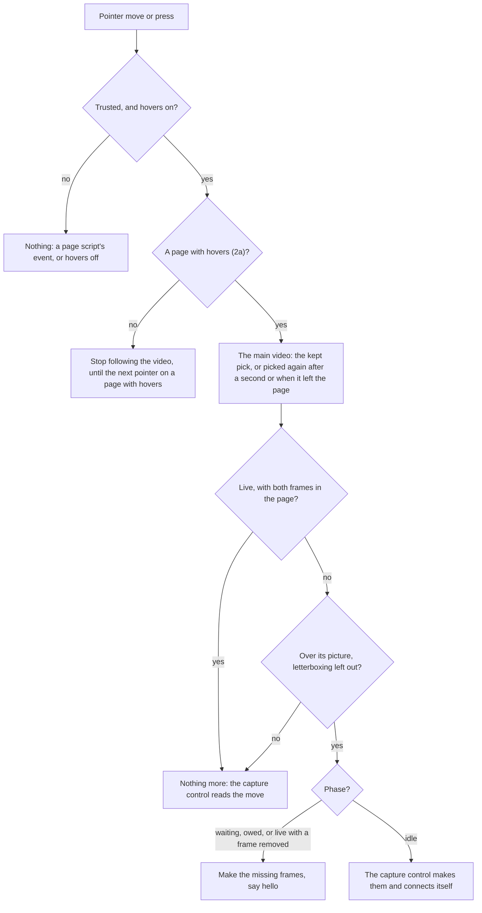

| Element | Anchors | Spec |
| --- | --- | --- |
| Trusted pointer, before the control reads it (`onPointer`, host `content.ts`) | | S-A2, S-A6, S-A10 |
| A pointer on a page without hovers stops following the video (`detachVideo`, host `content.ts`); a change from DuelSight's own code, which kept the video | | S-G5 |
| The main video: the largest on show, wide enough, with a picture; picked again at most once a second, or when it has left the page (`createVideoPick`, `pickMainVideo`, host `video-pick.ts`) | | S-G4 |
| Its picture on screen, for its `object-fit` (`pictureOf`, host `video-pick.ts`; `fractionIn`, the toolkit's `capture.ts`) | | S-B5 |
| After an idle removal, the capture control's own make (`whenIdle`, host `content.ts`) | | S-A6 |

### 2d. Does a point count? (host)

The toolkit's capture control asks the host on each pointer event and before each capture. A point
counts when it is over the main video's picture, on a page with hovers, with the switch on.

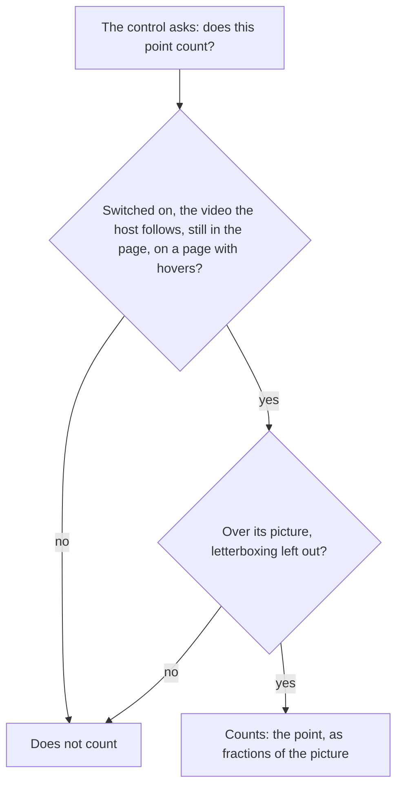

| Element | Anchors | Spec |
| --- | --- | --- |
| Does this point count (`eligible`, host `content.ts`) | | S-B5, S-G1, S-G5 |
| Its picture on screen (`pictureOf`, host `video-pick.ts`) | | S-B5 |

How the control uses the answer (the gate, its grants and its timings) is the toolkit's
[map, 2a](https://github.com/ryangswe/riftsight-vision/blob/e452420c7d1469bfd1690b46cfcb534447050e24/docs/hover-map.md#2a-may-a-picture-be-taken).

### 2e. Which hold does a compute frame start with? (host)

The popup's "Keep the card I'm pointing at" picks the toolkit's hold. The host's compute half reads
it once, when the frame starts and after the origin check, and keeps that hold for the frame's
life.

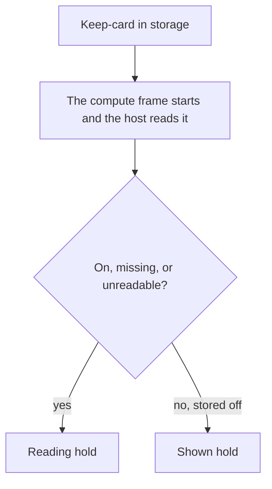

| Element | Anchors | Spec |
| --- | --- | --- |
| Read at start, on unless stored off (`startHostCompute`, host `compute.ts`; `createSwitches`, host `switches.ts`), under the key the popup writes (the host's `KEEP_CARD_KEY`) | `src/compute/compute.ts`, `src/popup/view.ts#initPopup` | S-H2 |
| Reading hold or shown hold | | S-W4, S-W6 |

The other options the host starts every compute frame with are the standard ones (`STANDARD_PRESET`,
host `compute.ts`): pointer mode, turned outlines, paced analysis and the idle time (S-F2, S-P1,
S-A4). A dev build made with `--idle-unload-ms` gives a shorter idle time, which the host takes in a
dev build only (`src/compute/compute.ts`). DuelSight has no geometric stage, so the host adds no
geometric options and refuses a load request that names one.

### 2f. When does a keep-card change make the compute frame again? (host)

Because the hold is fixed for a frame's life, a change of keep-card makes a new compute frame, now
in a tab in front, later in a tab behind. The tooltip frame stays.

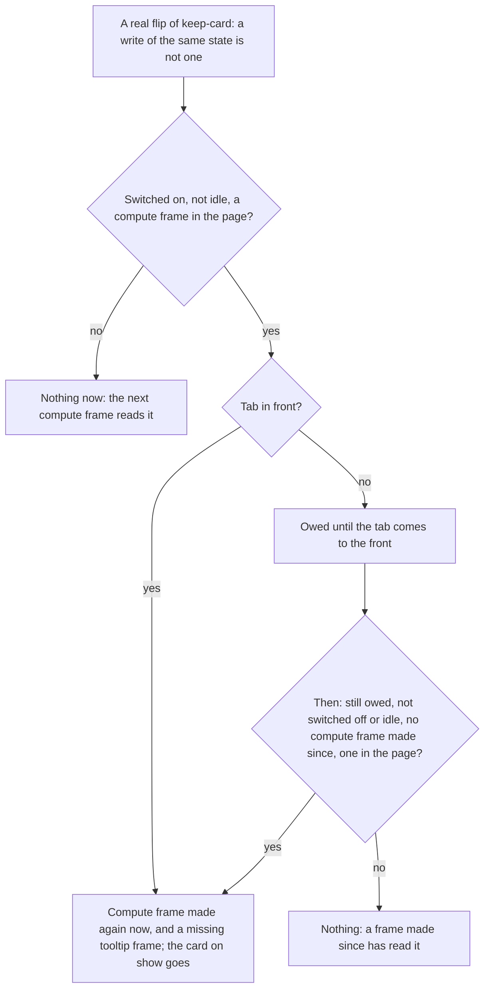

| Element | Anchors | Spec |
| --- | --- | --- |
| The flip, seen by the host's watch of the key the popup writes (`watch`, host `switches.ts`; the host's `KEEP_CARD_KEY`) | `src/popup/view.ts#initPopup` | S-H3 |
| Now, or when the tab comes to the front (`onKeepCard`, `onFront`, host `lifecycle.ts`; `remakeCompute`, host `content.ts`) | | S-H3 |
| A new compute frame, switching off, or an idle removal clears the wait (`made`, `onSwitch`, host `lifecycle.ts`) | | S-H3 |
| The card on show goes; the adapter is told to hide | `src/content/view.ts#hide` | S-H3 |

### 2g. Is the tooltip shown, and the outline with it? (host, with DuelSight's view adapter)

The capture control reports the shown card, or none, whenever it changes, and the tooltip frame
reports its size. Either way the host asks this again: it shows the card while one is named and the
viewer's pointer holds capture authority inside the picture, and hides it shortly after that stops.
Whether the tooltip frame may be seen is the adapter's answer: once it has measured itself for this
card.

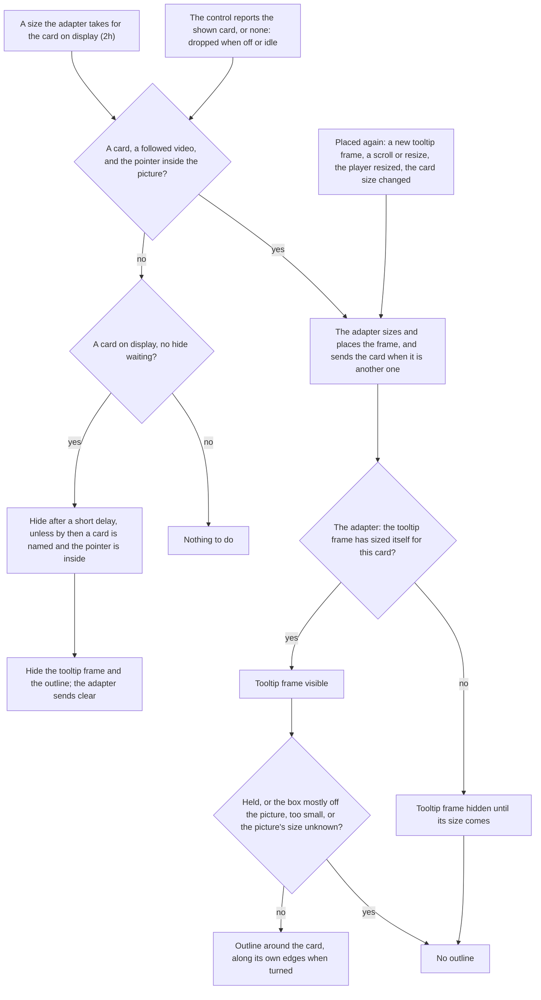

| Element | Anchors | Spec |
| --- | --- | --- |
| The shown card reaches the host, and is dropped when off or idle (`onShown`, host `content.ts`; the `shown` event, host `lifecycle.ts`) | | S-W8, S-B11 |
| A size from the tooltip frame: the adapter says whether it changed, and a stale one (another card, or an earlier showing of the same card) does not | `src/content/view.ts#message` | |
| Shown or hidden: the pointer holding capture authority (`updateCard`, `HIDE_DELAY_MS`, host `content.ts`) | | S-F1 |
| Placed again while a card is displayed (`onLayout`, `onScroll`, `relayout`, `showAgain`, host `content.ts`); DuelSight calls `relayout` when the card size changes | `src/content/card-size-sync.ts#startCardSizeSync`, `src/content/view.ts#setCardSize` | |
| Size, place, and send the card, numbered; true once sized for this card | `src/content/view.ts#show`, `src/content/view.ts#post` | |
| Visible once sized for this card (`showCard`, host `content.ts`) | `src/content/view.ts#show` | |
| Hide and clear (`hideCard`, host `content.ts`) | `src/content/view.ts#hide` | S-F1 |
| Outline, turned or upright: the box cut to the picture, or for a turned card the turned outline the toolkit hands, which fits inside the picture; the edge is drawn outside it (`outlinePlace`, `outlineRect`, `CardOutline`, host `outline.ts`) | `src/shared/product.ts#productConfig` | S-F1, S-F2, S-F3 |
| No outline on a held card (`outlinePlace`, host `outline.ts`) | | S-F4, S-W7 |

What makes the shown card (the hover rule and the hold) is the toolkit's
[map, 2d](https://github.com/ryangswe/riftsight-vision/blob/e452420c7d1469bfd1690b46cfcb534447050e24/docs/hover-map.md#2d-is-a-card-shown-and-is-it-held).

### 2h. How big is the tooltip?

The tooltip frame says its own size: a card-shaped picture, a pill with the name, or a picture
with a details panel. DuelSight's view adapter fits that into the page, from the layout the host
hands it (the card's box, the other cards, the window, the player's top).

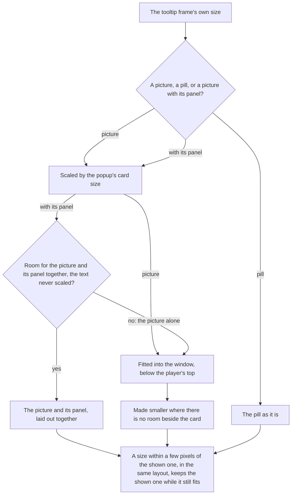

| Element | Anchors | Spec |
| --- | --- | --- |
| The tooltip frame's own size | `src/content/view.ts#message`, `src/shared/messages.ts#TooltipSize` | |
| Card size: read at start and on change | `src/content/card-size-sync.ts#startCardSizeSync`, `src/content/view.ts#setCardSize`, `src/content/geometry.ts#scaleTooltipSize` | |
| Into the window | `src/content/view.ts#show`, `src/content/geometry.ts#fitTooltipSize`, `src/content/geometry.ts#availableSpace`, `src/content/geometry.ts#MIN_ART_WIDTH` | |
| Beside the card | `src/content/geometry.ts#fitBesideCard`, `src/content/geometry.ts#fitsBesideCard` | |
| With the details panel | `src/content/geometry.ts#fitWithPanel`, `src/content/geometry.ts#PanelFit`, `src/shared/panel-layout.ts#arrange`, `src/shared/panel-layout.ts#panelHeightAt` | |
| No breathing | `src/content/view.ts#show`, `src/content/view.ts#SIZE_HYSTERESIS_PX` | |
| Corners | `src/content/geometry.ts#tooltipRadius`, `src/content/geometry.ts#CARD_CORNER` | |

### 2i. Where does the tooltip go?

With its size known, the adapter picks a place beside the card, off it and off the other cards the
shown card lists, and keeps the tooltip where it is rather than make it jump.

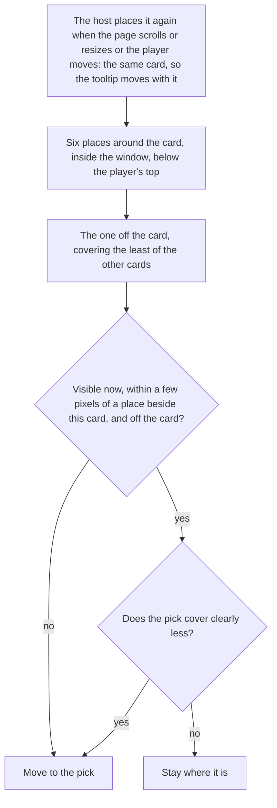

| Element | Anchors | Spec |
| --- | --- | --- |
| The places and the pick | `src/content/geometry.ts#placeTooltipAvoiding`, `src/content/geometry.ts#CARD_PAD`, `src/content/geometry.ts#TOOLTIP_GAP`, `src/content/geometry.ts#VIEWPORT_MARGIN` | |
| Staying put | `src/content/geometry.ts#placeTooltipAvoiding`, `src/content/geometry.ts#STICKY_PX`, `src/content/geometry.ts#clearlyBetter`, `src/content/geometry.ts#Coverage` | |
| Moving with the card: the host's layout events (`onLayout`, `onScroll`, host `content.ts`), the adapter's last place moved by as much as the card moved | `src/content/view.ts#show` | |

### 2j. What does the tooltip frame draw?

The tooltip frame takes a card message from the page that holds it, finds the card's facts, and
draws its picture, its name, or its picture with the details panel. Each time what it draws
changes size, it tells the content script.

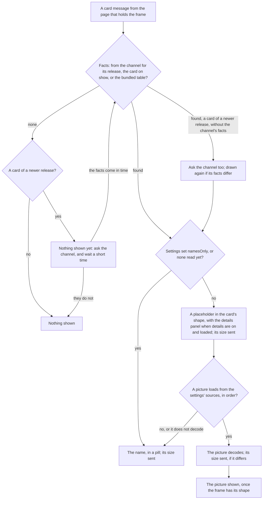

| Element | Anchors | Spec |
| --- | --- | --- |
| A card message, checked by source, origin and shape | `src/tooltip/controller.ts#connectTooltipFrame`, `src/shared/messages.ts#parseTooltipIn` | S-B9 |
| The card's facts | `src/tooltip/controller.ts#TooltipController.lookup`, `src/tooltip/controller.ts#knownCard`, `src/tooltip/controller.ts#TooltipController.addFacts` | |
| Ask the channel and wait | `src/tooltip/controller.ts#TooltipController.show`, `src/tooltip/controller.ts#FACTS_WAIT_MS` | |
| Ask the channel too, and draw again if its facts differ | `src/tooltip/controller.ts#TooltipController.show`, `src/tooltip/controller.ts#TooltipController.addFacts` | |
| Nothing shown | `src/tooltip/controller.ts#TooltipController.clear` | |
| The name, in a pill | `src/tooltip/controller.ts#TooltipController.showPill`, `src/tooltip/tooltip.ts` | |
| Placeholder and details panel | `src/tooltip/controller.ts#artSize`, `src/tooltip/controller.ts#TooltipController.fillPanel`, `src/tooltip/panel-dom.ts#measurePanel`, `src/tooltip/panel-dom.ts#fitPanelText` | |
| A picture from the sources | `src/tooltip/controller.ts#TooltipController.resolve`, `src/images/chain.ts#resolveCardImage`, `src/images/chain.ts#loadImage`, `src/images/chain.ts#SourceHealth` | |
| Once the frame has its shape | `src/tooltip/frame-shape.ts#frameHasShape`, `src/tooltip/frame-shape.ts#FRAME_SHAPE_TIMEOUT_MS`, `src/tooltip/controller.ts#TooltipController.layout` | |
| Its size, when it differs from the last sent | `src/tooltip/controller.ts#TooltipController.postSize` | |
| Settings and details change while shown | `src/tooltip/controller.ts#TooltipController.setSettings`, `src/tooltip/controller.ts#TooltipController.setDetails`, `src/tooltip/controller.ts#TooltipController.refreshPanel` | |

## Layer 3: flows

### 3a. A hover on a watch page

The video plays on a YouTube watch page, in a tab in front. Both frames are made then, so the model
has loaded by the time the viewer points at a card. Inside the compute frame, the steps from the
pointer to the shown card are the toolkit's
[map, 3a](https://github.com/ryangswe/riftsight-vision/blob/e452420c7d1469bfd1690b46cfcb534447050e24/docs/hover-map.md#3a-the-opening-hover-on-a-fresh-tab).

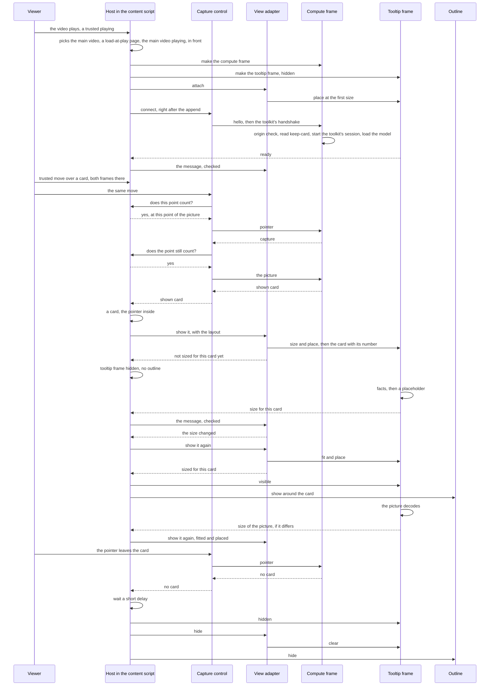

| Step | Anchors | Spec |
| --- | --- | --- |
| The video plays (`onPlaying`, host `content.ts` and `lifecycle.ts`) | | S-A1, S-G4 |
| Both frames made, the adapter attached (`makeMissing`, host `content.ts`) | `src/content/view.ts#attach` | S-A1, S-B8 |
| Connect right after the append | | |
| The compute frame starts | `src/compute/compute.ts` | S-H2, S-B9 |
| The tooltip frame says ready | `src/tooltip/tooltip.ts`, `src/content/view.ts#message` | |
| Does the point count, at the pointer and before the capture (`eligible`, host `content.ts`) | | S-B5 |
| The shown card (`onShown`, `updateCard`, host `content.ts`) | | S-W8 |
| Placed, the card sent, hidden until sized | `src/content/view.ts#show`, `src/content/view.ts#post` | |
| The tooltip frame draws and sizes | `src/tooltip/controller.ts#TooltipController.show`, `src/tooltip/controller.ts#TooltipController.postSize` | |
| Visible, and the outline (`showCard`, host `content.ts`) | `src/content/view.ts#show` | S-F1 |
| Hidden after a delay (`updateCard`, `hideCard`, host `content.ts`) | `src/content/view.ts#hide` | S-F1 |

### 3b. A card of a newer release

The settings name a newer card release than the one bundled, and the compute frame loaded it. The
tooltip frame's bundled table may not have the card, so the compute frame sends its facts on the
facts channel, which a web page cannot reach, before the host's compute half posts the card. A
tooltip frame made again, or one that got the card before its facts, asks on the channel, and is
answered for a card that compute frame showed.

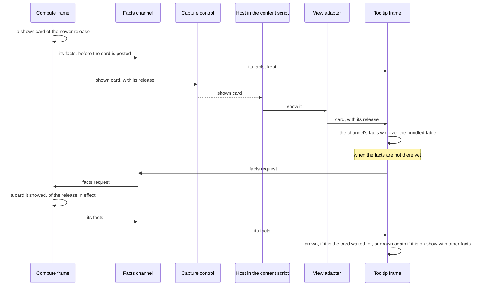

| Step | Anchors | Spec |
| --- | --- | --- |
| A shown card's facts sent: the host calls `onShown` before it posts the card | `src/compute/frame.ts#createFactsChannel`, `src/compute/frame.ts#SHOWN_IDS_LIMIT`, `src/compute/compute.ts` | |
| Kept by the tooltip frame | `src/tooltip/tooltip.ts`, `src/tooltip/controller.ts#TooltipController.addFacts`, `src/tooltip/controller.ts#FACTS_LIMIT` | |
| Card with its release | `src/content/view.ts#show`, `src/shared/messages.ts#TooltipIn` | |
| Facts looked up | `src/tooltip/controller.ts#TooltipController.lookup` | |
| A request | `src/tooltip/controller.ts#TooltipController.show`, `src/shared/messages.ts#parseFactsRequest` | |
| Answered for a shown card, of the release in effect | `src/compute/compute.ts`, `src/compute/frame.ts#FactsChannel` | |

## Coverage

These files are the map's coverage. Each must carry at least one anchor above, and a change to one
of them updates this page in the same pull request. Not covered: the toolkit's runtime and the
shared hover host under `vendor/` (the toolkit's own map, and the host's source in the toolkit's
`browser/src/host/`), the settings file and its checks (`src/settings/`), the details files and
the card language (`src/details/`, the tooltip frame's details sync, the popup's details and
language controls), the background's refresh rule, and the build.

- `src/compute/compute.ts`
- `src/compute/frame.ts`
- `src/compute/load-request.ts`
- `src/content/card-size-sync.ts`
- `src/content/geometry.ts`
- `src/content/index.ts`
- `src/content/view.ts`
- `src/images/chain.ts`
- `src/popup/card-size-control.ts`
- `src/popup/switch-control.ts`
- `src/popup/view.ts`
- `src/shared/card-size.ts`
- `src/shared/messages.ts`
- `src/shared/panel-layout.ts`
- `src/shared/product.ts`
- `src/tooltip/controller.ts`
- `src/tooltip/frame-shape.ts`
- `src/tooltip/panel-dom.ts`
- `src/tooltip/tooltip.ts`
