<!-- SPDX-License-Identifier: Apache-2.0 -->

# Hover map

A map of DuelSight's own hover code: the content script and its wiring to the video sites, the
choice of video, the compute frame's options, the tooltip frame and where the tooltip goes, the
outline, and the popup's choices as far as they change a hover. It covers the files listed under
[Coverage](#coverage) and nothing else.

The runtime inside the compute frame, and the half of the session the content script runs for it
(the toolkit's capture control), are the cardvision toolkit's. They have their own
[hover map](https://github.com/ryangswe/riftsight-vision/blob/main/docs/hover-map.md), which this
page links to and does not draw again. The rules are clauses of the toolkit's
[hover spec](https://github.com/ryangswe/riftsight-vision/blob/b858925b9a764ace8866a8c1de4bfa4020795512/docs/hover-spec.md),
at the commit DuelSight vendors. This page shows the structure and the flows: which part decides
what, and in what order the parts talk. It does not repeat the rules; each element names the
clauses it carries out.

**Checked by `test/hover-map.test.ts`.** Every anchor below must name a file that exists and a
symbol that file defines, every clause id must be one of the vendored spec's
(`vendor/cardvision-browser/hover-spec.json`), and every covered file must be anchored at least
once. The test checks names. It does not check behavior: a diagram can be wrong while its names
are right, so a change to a covered file updates this page in the same pull request, and the
reviewer reads the diagram.

## How to read it

Three layers, from the whole to the detail.

1. **Frames and messages.** Who runs where, and what they send each other.
2. **Decision points.** The questions DuelSight's code asks: what a page gets, when the frames
   are made, whether a point counts, which hold and when it changes, whether a card is shown, the
   tooltip's size and place, and what it draws.
3. **Flows.** Two cases as sequence diagrams, from the opening event to the card on screen.

Under each diagram a table lists its elements. Each row names an element or a part of one, the
anchors of its code, and the spec clauses it carries out.

- An anchor is `` `src/<file>.ts#<symbol>` ``. A symbol is a function, class, constant, type or
  interface, or `Class.member` for a method or an arrow-function property of that class. A file
  with no symbol (`` `src/compute/compute.ts` ``) is a page's start-up code, which has no name.
- A clause is written `S-A1` and is defined in the hover spec.
- Times and thresholds are in the spec and the code, not here.

How the diagrams are drawn, as in the toolkit's map:

- **One diagram answers one question.** A diagram that answers two is split, however small. A big
  diagram that answers one question stays whole; about 15 nodes is a prompt to check whether it
  answers two, not a limit.
- **The overview comes before the detail.** Layer 1 is the overview. Layers 2 and 3 zoom in. Each
  split follows a seam in the code: a separate policy, phase or component.
- On GitHub, a large diagram can be zoomed, or opened full screen, from the buttons that appear
  over it.

## Layer 1: the frames and their messages

DuelSight runs in three places in a video page: the content script in the page itself, and two
hidden-from-the-page extension frames inside it. The compute frame holds the toolkit's session and
its worker. The tooltip frame draws the card. The content script makes both frames, follows the
main video, places the tooltip and draws the outline.

### 1a. Who talks to whom

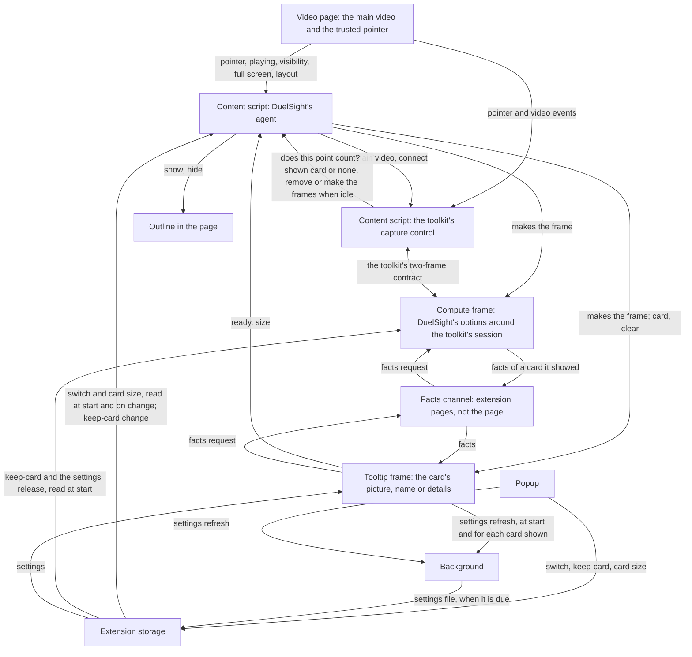

| Element | Anchors | Spec |
| --- | --- | --- |
| Content script entry: the switch and the card size read at start, each applied when read (hovers stay off until the switch is read; a switch that cannot be read is on; a popup change made while a read is pending wins over it) | `src/content/index.ts`, `src/content/storage-sync.ts#startStorageSync`, `src/content/storage-sync.ts#applyStoredChoices` | S-H1 |
| Content script: DuelSight's agent | `src/content/agent.ts#Agent`, `src/content/agent.ts#Agent.start`, `src/content/agent.ts#Agent.stop`, `src/content/agent.ts#AgentOptions` | S-A1, S-A2 |
| The agent makes the frames | `src/content/agent.ts#Agent.ensureCompute`, `src/content/agent.ts#Agent.createTooltip` | S-A1, S-A2 |
| The capture control, and what it asks the agent | `src/content/agent.ts#Agent.constructor`, `src/content/agent.ts#Agent.eligibleAt`, `src/content/agent.ts#PROTOCOL` | S-A4, S-A6, S-X2 |
| The main video, and connect | `src/content/agent.ts#Agent.setVideo`, `src/content/agent.ts#Agent.ensureCompute` | S-B6 |
| Messages from the frames: the compute frame's to the control, the tooltip's checked | `src/content/agent.ts#Agent.onMessage`, `src/shared/messages.ts#parseTooltipOut` | S-B9 |
| Content script to tooltip frame | `src/content/agent.ts#Agent.toTooltip`, `src/shared/messages.ts#TooltipIn`, `src/shared/messages.ts#tag`, `src/shared/messages.ts#TAG` | |
| Tooltip frame to content script | `src/shared/messages.ts#TooltipOut`, `src/shared/messages.ts#TooltipSize` | |
| Compute frame | `src/compute/compute.ts`, `src/compute/frame.ts#startDuelSightFrame`, `src/compute/frame.ts#computeFrameEnv`, `src/compute/frame.ts#DuelSightFrameEnv`, `src/compute/frame.ts#PROTOCOL`, `src/compute/load-request.ts#buildLoadRequest` | S-X2, S-X3 |
| Which pages a frame serves | `src/shared/messages.ts#allowedParentOrigin` | S-B9 |
| Tooltip frame: takes messages from the page that holds it, by source and origin | `src/tooltip/tooltip.ts`, `src/tooltip/controller.ts#TooltipController`, `src/tooltip/controller.ts#connectTooltipFrame` | S-B9 |
| Facts channel | `src/shared/messages.ts#FACTS_CHANNEL`, `src/shared/messages.ts#CardFactsMessage`, `src/shared/messages.ts#FactsRequest`, `src/shared/messages.ts#parseCardFacts`, `src/shared/messages.ts#parseFactsRequest`, `src/compute/frame.ts#createFactsChannel`, `src/compute/frame.ts#FactsChannel` | |
| Outline in the page | `src/content/outline.ts#CardOutline` | S-F1 |
| Popup: the main switch | `src/popup/view.ts#initPopup`, `src/shared/enabled.ts#ENABLED_KEY`, `src/shared/enabled.ts#readEnabled` | S-H1 |
| Popup: keep-card and card size | `src/popup/switch-control.ts#initStoredSwitch`, `src/popup/card-size-control.ts#initCardSize`, `src/shared/keep-card.ts#KEEP_CARD_KEY`, `src/shared/card-size.ts#CARD_SIZE_KEY` | S-H2 |
| Storage to the content script | `src/content/storage-sync.ts#startStorageSync`, `src/content/storage-sync.ts#applyStorageChange`, `src/shared/keep-card.ts#keepCardFlipped`, `src/shared/card-size.ts#clampCardSize`, `src/shared/card-size.ts#readCardSize` | S-H1, S-H3 |
| Read when the compute frame starts | `src/shared/keep-card.ts#keepCardForFrame`, `src/shared/keep-card.ts#readKeepCardOn`, `src/compute/compute.ts` | S-H2 |
| Settings refresh: asked by the tooltip frame and the popup, fetched by the background when due | `src/tooltip/tooltip.ts`, `src/tooltip/controller.ts#TooltipController.show`, `src/popup/popup.ts`, `src/background/index.ts` | |

Inside the compute frame, from the session core to the worker, is the toolkit's
[map, 1b](https://github.com/ryangswe/riftsight-vision/blob/main/docs/hover-map.md#1b-inside-the-compute-frame).

### 1b. The life of the frames

Hovers start off, and come on when the content script has read the stored switch, or failed to
(`applyStoredChoices`). The
content script makes both frames together: when the main video plays on a page that loads at play
(at its `playing` event, when hovers are switched on, or when a waiting tab comes into view), or at
a trusted move or tap over the picture. A tab switched on out of view after an idle unload waits
for the front. The toolkit asks for them to go when the
compute frame is idle, and the popup's switch removes them. A keep-card change makes the compute
frame again and keeps the tooltip frame.

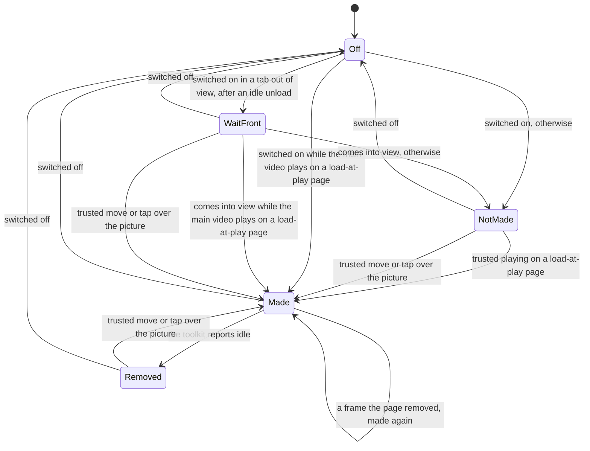

| Element | Anchors | Spec |
| --- | --- | --- |
| Both frames made together | `src/content/agent.ts#Agent.ensureFrames`, `src/content/agent.ts#Agent.ensureCompute`, `src/content/agent.ts#Agent.createTooltip` | S-A1, S-A2 |
| A frame the page removed is made again at the next trusted play or pointer move. Today the tooltip frame alone is also made again when a card is shown, full screen changes, or, while a card is displayed, the page is resized or scrolled, the player resizes or the card size changes, which S-A10 does not have | `src/content/agent.ts#Agent.ensureFrames`, `src/content/agent.ts#Agent.ensureCompute`, `src/content/agent.ts#Agent.showTooltip` | S-A10 |
| The handshake starts when the compute frame's page has loaded | `src/content/agent.ts#Agent.ensureCompute` | |
| Idle: the toolkit asks for the frames to go, and to come back | `src/content/agent.ts#Agent.constructor`, `src/content/agent.ts#Agent.removeFrames`, `src/compute/frame.ts#computeFrameEnv` | S-A4, S-A6 |
| A move or tap over the picture makes them again | `src/content/agent.ts#Agent.onPointer` | S-A6 |
| Keep-card changed | `src/content/agent.ts#Agent.keepCardChanged`, `src/content/agent.ts#Agent.remakeCompute` | S-H3 |
| Full screen | `src/content/agent.ts#Agent.onFullscreen`, `src/content/agent.ts#Agent.mountHost` | |
| Switched off, switched on | `src/content/agent.ts#Agent.setEnabled`, `src/content/agent.ts#Agent.teardown`, `src/content/agent.ts#Agent.reloadAfterSwitch` | S-H1, S-B11, S-A7 |
| Waiting for the front: out of view after an idle unload (a tab out of view whose frames were not unloaded loads at once) | `src/content/agent.ts#Agent.setEnabled`, `src/content/agent.ts#Agent.onVisibility` | S-A7 |

The compute frame's own life inside, from loading to idle, is the toolkit's
[map, 1c](https://github.com/ryangswe/riftsight-vision/blob/main/docs/hover-map.md#1c-the-life-of-the-frames).

## Layer 2: the decision points

### 2a. What does a page get?

Each page of the video sites gets one of three things: nothing, hovers that load the model at the
pointer, or hovers that load it when the video plays.

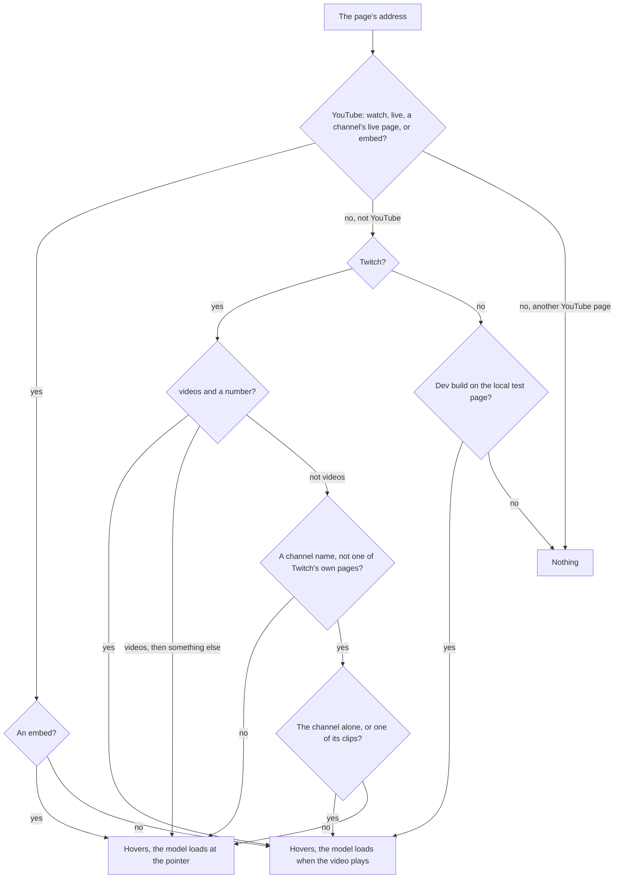

| Element | Anchors | Spec |
| --- | --- | --- |
| Pages with hovers | `src/content/site.ts#isActivePage` | S-G1 |
| Pages that load when the video plays | `src/content/site.ts#loadsAtPlay` | S-G2, S-G3 (not yet, below) |
| Twitch's own pages and channel names | `src/content/site.ts#TWITCH_NOT_CHANNEL`, `src/content/site.ts#TWITCH_CHANNEL` | S-G3 (not yet, below) |
| A channel's live page on YouTube | `src/content/site.ts#CHANNEL_LIVE` | S-G1, S-G2 |

**Not yet as the spec has it.** S-G3's address rule is one shared list and one strict check, which
DuelSight takes with the toolkit's shared host in its next minor release. Until then, `loadsAtPlay`
differs from it in four ways, the ones S-G3 itself names:
- five of S-G3's seven side pages (`/collections`, `/payments`, `/privacy`, `/products`, `/team`)
  are not in `TWITCH_NOT_CHANNEL`, so they pass as channel names and load at play;
- the `videos` test ignores case, so `/Videos/123` loads at play;
- empty path parts are dropped, so repeated slashes (`//name`, `/videos//123`) load at play;
- a clip's slug is not checked, so a clip address with any slug loads at play.

S-A8 has a video that starts playing in a tab out of view wait until the tab comes to the front.
DuelSight makes the frames at once there today (2b); that change comes with the shared host too.

### 2b. Do the frames load when the video plays?

A `playing` event, the switch turned on, or a waiting tab coming into view asks this. A video that
never plays loads at the pointer instead (2c).

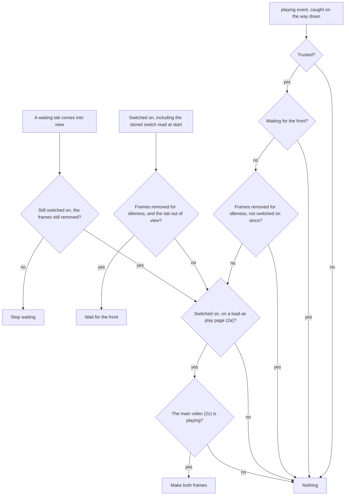

| Element | Anchors | Spec |
| --- | --- | --- |
| The `playing` event | `src/content/agent.ts#Agent.start`, `src/content/agent.ts#Agent.onPlaying` | S-A1 |
| Waiting for the front, and removed for idleness | `src/content/agent.ts#Agent.onPlaying` | S-A6, S-A7 |
| Switched on: at once, or wait for the front | `src/content/index.ts`, `src/content/storage-sync.ts#applyStoredChoices`, `src/content/agent.ts#Agent.setEnabled`, `src/content/agent.ts#Agent.reloadAfterSwitch` | S-A7 |
| A waiting tab comes into view | `src/content/agent.ts#Agent.onVisibility`, `src/content/agent.ts#Agent.reloadAfterSwitch` | S-A7 |
| Load-at-play page, main video playing; in a tab out of view too, where S-A8 has it wait (not yet, 2a) | `src/content/agent.ts#Agent.loadIfPlaying`, `src/content/site.ts#loadsAtPlay` | S-A1, S-A8 (not yet) |
| Make both frames | `src/content/agent.ts#Agent.ensureFrames` | S-B8 |

### 2c. Does a pointer make the frames?

The content script follows one video: the largest on show. A trusted move or press over that
video's picture makes the frames when they are not there. It runs before the toolkit's capture
control reads the same event.

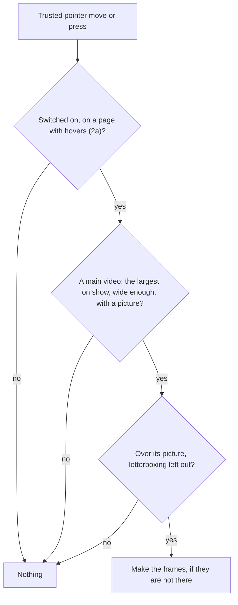

| Element | Anchors | Spec |
| --- | --- | --- |
| Trusted pointer, before the control reads it | `src/content/agent.ts#Agent.start`, `src/content/agent.ts#Agent.onPointer` | S-A2, S-A6 |
| The main video: picked again at a trusted pointer event a second after the last pick, or when it has left the page, and whenever 2b reaches its load-at-play check; not at every `playing`, which S-G4 has | `src/content/agent.ts#Agent.currentVideo`, `src/content/agent.ts#Agent.setVideo`, `src/content/agent.ts#Agent.loadIfPlaying` | S-G4 |
| Its picture on screen | `src/content/agent.ts#Agent.pictureOf`, `src/content/geometry.ts#pictureRect`, `src/content/geometry.ts#fractionIn`, `src/content/geometry.ts#Rect` | S-B5 |

### 2d. Does a point count?

The toolkit's capture control asks the content script on each pointer event and before each
capture. A point counts when it is over the main video's picture, on a page with hovers, with the
switch on.

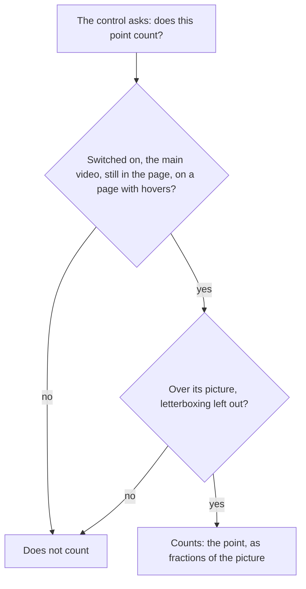

| Element | Anchors | Spec |
| --- | --- | --- |
| Does this point count | `src/content/agent.ts#Agent.eligibleAt`, `src/content/agent.ts#Agent.constructor` | S-B5, S-G1, S-G5 |
| Its picture on screen | `src/content/agent.ts#Agent.pictureOf`, `src/content/geometry.ts#fractionIn` | S-B5 |

How the control uses the answer (the gate, its grants and its timings) is the toolkit's
[map, 2a](https://github.com/ryangswe/riftsight-vision/blob/main/docs/hover-map.md#2a-may-a-picture-be-taken).

### 2e. Which hold does a compute frame start with?

The popup's "Keep the card I'm pointing at" picks the toolkit's hold. The compute frame reads it
once, when it starts, and keeps that hold for its life.

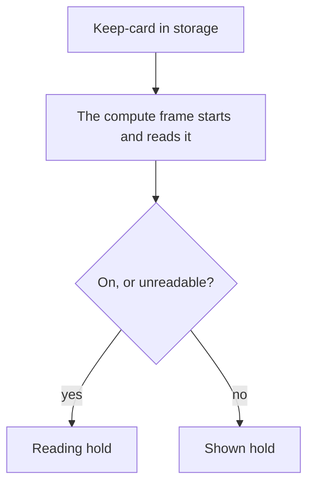

| Element | Anchors | Spec |
| --- | --- | --- |
| Read at start, on when unreadable | `src/shared/keep-card.ts#keepCardForFrame`, `src/shared/keep-card.ts#readKeepCardOn`, `src/compute/compute.ts` | S-H2 |
| Reading hold or shown hold | `src/compute/frame.ts#computeFrameEnv` | S-W4, S-W6 |

The other options DuelSight starts the compute frame with: turned outlines, paced analysis and the
idle time. They are in the same function, `computeFrameEnv` (S-F2, S-P1, S-A4).

### 2f. When does a keep-card change make the compute frame again?

Because the hold is fixed for a frame's life, a change of keep-card makes a new compute frame, now
in a tab in view, later in a tab out of view. The tooltip frame stays.

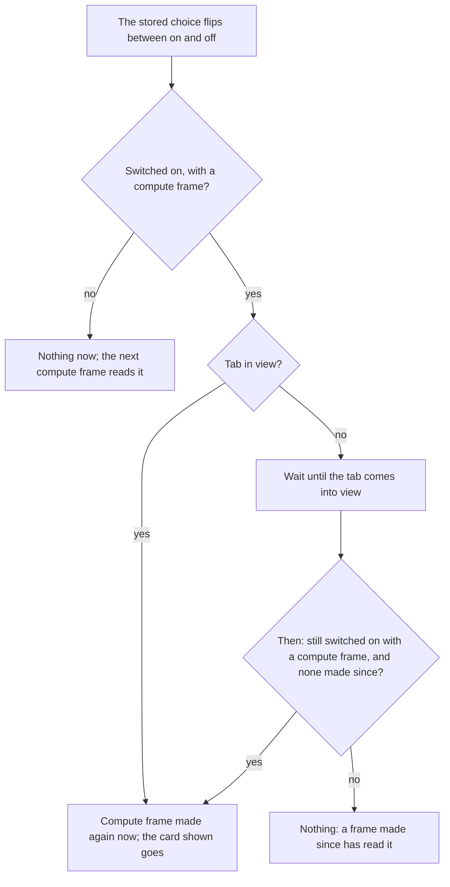

| Element | Anchors | Spec |
| --- | --- | --- |
| The stored choice flips | `src/content/storage-sync.ts#applyStorageChange`, `src/shared/keep-card.ts#keepCardFlipped` | S-H3 |
| Now, or when the tab comes into view | `src/content/agent.ts#Agent.keepCardChanged`, `src/content/agent.ts#Agent.onVisibility`, `src/content/agent.ts#Agent.remakeCompute` | S-H3 |
| A frame made since clears the wait | `src/content/agent.ts#Agent.ensureCompute` | S-H3 |

### 2g. Is the tooltip shown, and the outline with it?

The control reports the shown card, or none, whenever it changes, and the tooltip frame reports
its size. Either way the content script asks this again: it shows the tooltip while a card is
shown and the pointer is inside the picture, and hides it shortly after that stops.

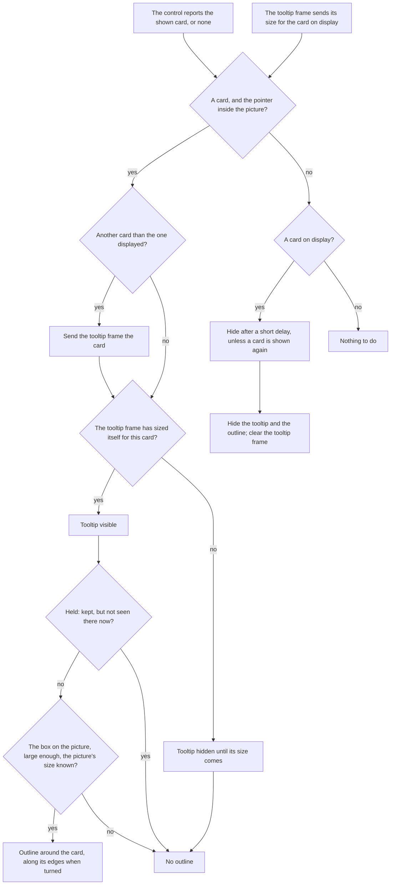

| Element | Anchors | Spec |
| --- | --- | --- |
| The shown card reaches the content script | `src/content/agent.ts#Agent.constructor` | S-W8 |
| A size from the tooltip frame | `src/content/agent.ts#Agent.onMessage` | |
| Shown or hidden | `src/content/agent.ts#Agent.updateTooltip`, `src/content/agent.ts#HIDE_DELAY_MS` | S-F1 |
| Send the card, numbered | `src/content/agent.ts#Agent.showTooltip`, `src/content/agent.ts#Agent.toTooltip` | |
| Visible once sized for this card | `src/content/agent.ts#Agent.onMessage`, `src/content/agent.ts#Agent.showTooltip` | |
| Hide and clear | `src/content/agent.ts#Agent.hideTooltip` | S-F1 |
| Outline, turned or upright; a turned outline is drawn as the toolkit hands it, which fits inside the card's box already cut to the picture (its edge is drawn 2 px outside) | `src/content/outline.ts#outlinePlacement`, `src/content/outline.ts#outlineRect`, `src/content/outline.ts#OutlinePlacement`, `src/content/outline.ts#OutlinedCard`, `src/content/outline.ts#MIN_OUTLINE_SIDE`, `src/content/outline.ts#CardOutline.show`, `src/content/outline.ts#CardOutline.hide` | S-F1, S-F2, S-F3 |
| No outline on a held card | `src/content/agent.ts#Agent.showTooltip` | S-F4, S-W7 |
| How the outline looks | `src/content/outline.ts#outlineEdgeStyle`, `src/content/outline.ts#OutlineEnvironment` | |

What makes the shown card (the hover rule and the hold) is the toolkit's
[map, 2d](https://github.com/ryangswe/riftsight-vision/blob/main/docs/hover-map.md#2d-is-a-card-shown-and-is-it-held).

### 2h. How big is the tooltip?

The tooltip frame says its own size: a card-shaped picture, a pill with the name, or a picture
with a details panel. The content script fits that into the page.

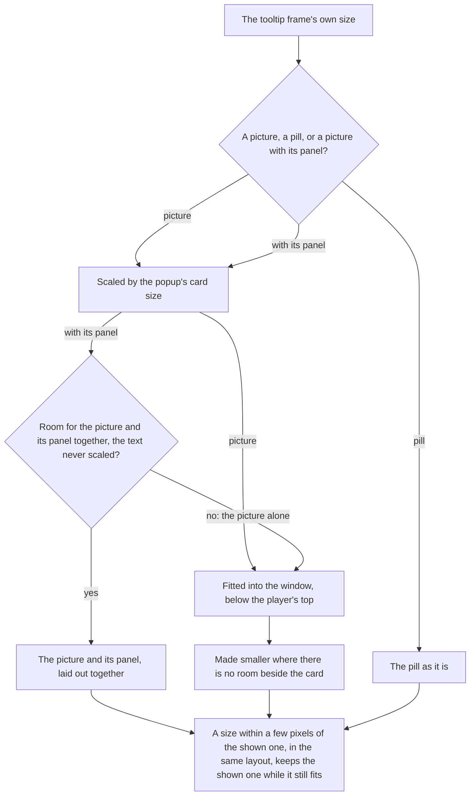

| Element | Anchors | Spec |
| --- | --- | --- |
| The tooltip frame's own size | `src/content/agent.ts#Agent.onMessage`, `src/shared/messages.ts#TooltipSize` | |
| Card size | `src/content/agent.ts#Agent.setCardSize`, `src/content/geometry.ts#scaleTooltipSize` | |
| Into the window | `src/content/geometry.ts#fitTooltipSize`, `src/content/geometry.ts#availableSpace`, `src/content/geometry.ts#MIN_ART_WIDTH` | |
| Beside the card | `src/content/geometry.ts#fitBesideCard`, `src/content/geometry.ts#fitsBesideCard` | |
| With the details panel | `src/content/geometry.ts#fitWithPanel`, `src/content/geometry.ts#PanelFit`, `src/shared/panel-layout.ts#arrange`, `src/shared/panel-layout.ts#panelHeightAt` | |
| No breathing | `src/content/agent.ts#Agent.showTooltip`, `src/content/agent.ts#SIZE_HYSTERESIS_PX` | |
| Corners | `src/content/geometry.ts#tooltipRadius`, `src/content/geometry.ts#CARD_CORNER` | |

### 2i. Where does the tooltip go?

With its size known, the content script picks a place beside the card, off it and off the other
cards the shown card lists, and keeps the tooltip where it is rather than make it jump.

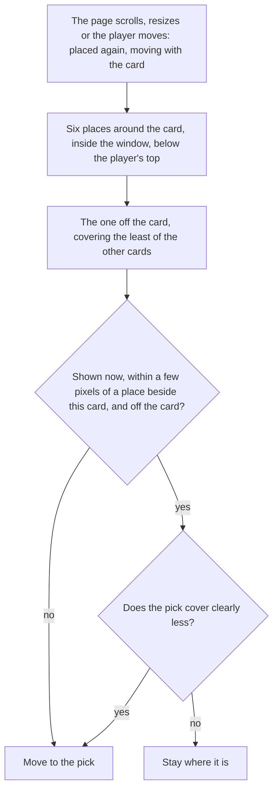

| Element | Anchors | Spec |
| --- | --- | --- |
| The places and the pick | `src/content/geometry.ts#placeTooltipAvoiding`, `src/content/geometry.ts#CARD_PAD`, `src/content/geometry.ts#TOOLTIP_GAP`, `src/content/geometry.ts#VIEWPORT_MARGIN` | |
| Staying put | `src/content/geometry.ts#placeTooltipAvoiding`, `src/content/geometry.ts#STICKY_PX`, `src/content/geometry.ts#clearlyBetter`, `src/content/geometry.ts#Coverage` | |
| Moving with the card | `src/content/agent.ts#Agent.showTooltip`, `src/content/agent.ts#Agent.onLayout`, `src/content/agent.ts#Agent.onScroll` | |

### 2j. What does the tooltip frame draw?

The tooltip frame takes a card message from the page that holds it, finds the card's facts, and
draws its picture, its name, or its picture with the details panel. Each time what it draws
changes size, it tells the content script.

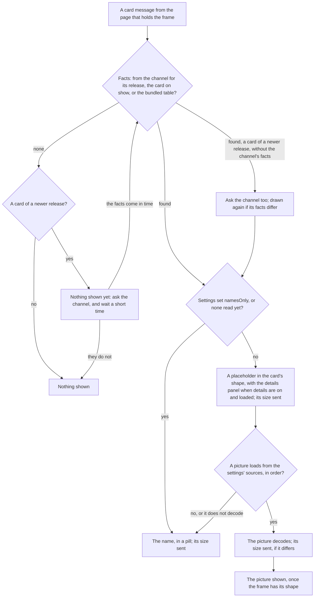

| Element | Anchors | Spec |
| --- | --- | --- |
| A card message, checked by source, origin and shape | `src/tooltip/controller.ts#connectTooltipFrame`, `src/shared/messages.ts#parseTooltipIn` | S-B9 |
| The card's facts | `src/tooltip/controller.ts#TooltipController.lookup`, `src/tooltip/controller.ts#knownCard`, `src/tooltip/controller.ts#TooltipController.addFacts` | |
| Ask the channel and wait | `src/tooltip/controller.ts#TooltipController.show`, `src/tooltip/controller.ts#FACTS_WAIT_MS` | |
| Ask the channel too, and draw again if its facts differ | `src/tooltip/controller.ts#TooltipController.show`, `src/tooltip/controller.ts#TooltipController.addFacts` | |
| Nothing shown | `src/tooltip/controller.ts#TooltipController.clear` | |
| The name, in a pill | `src/tooltip/controller.ts#TooltipController.showPill`, `src/tooltip/tooltip.ts` | |
| Placeholder and details panel | `src/tooltip/controller.ts#artSize`, `src/tooltip/controller.ts#TooltipController.fillPanel`, `src/tooltip/panel-dom.ts#measurePanel`, `src/tooltip/panel-dom.ts#fitPanelText` | |
| A picture from the sources | `src/tooltip/controller.ts#TooltipController.resolve`, `src/images/chain.ts#resolveCardImage`, `src/images/chain.ts#loadImage`, `src/images/chain.ts#SourceHealth` | |
| Once the frame has its shape | `src/tooltip/frame-shape.ts#frameHasShape`, `src/tooltip/frame-shape.ts#FRAME_SHAPE_TIMEOUT_MS`, `src/tooltip/controller.ts#TooltipController.layout` | |
| Its size, when it differs from the last sent | `src/tooltip/controller.ts#TooltipController.postSize` | |
| Settings and details change while shown | `src/tooltip/controller.ts#TooltipController.setSettings`, `src/tooltip/controller.ts#TooltipController.setDetails`, `src/tooltip/controller.ts#TooltipController.refreshPanel` | |

## Layer 3: flows

### 3a. A hover on a watch page

The video plays on a YouTube watch page. Both frames are made then, so the model has loaded by the
time the viewer points at a card. Inside the compute frame, the steps from the pointer to the shown
card are the toolkit's
[map, 3a](https://github.com/ryangswe/riftsight-vision/blob/main/docs/hover-map.md#3a-the-opening-hover-on-a-fresh-tab).

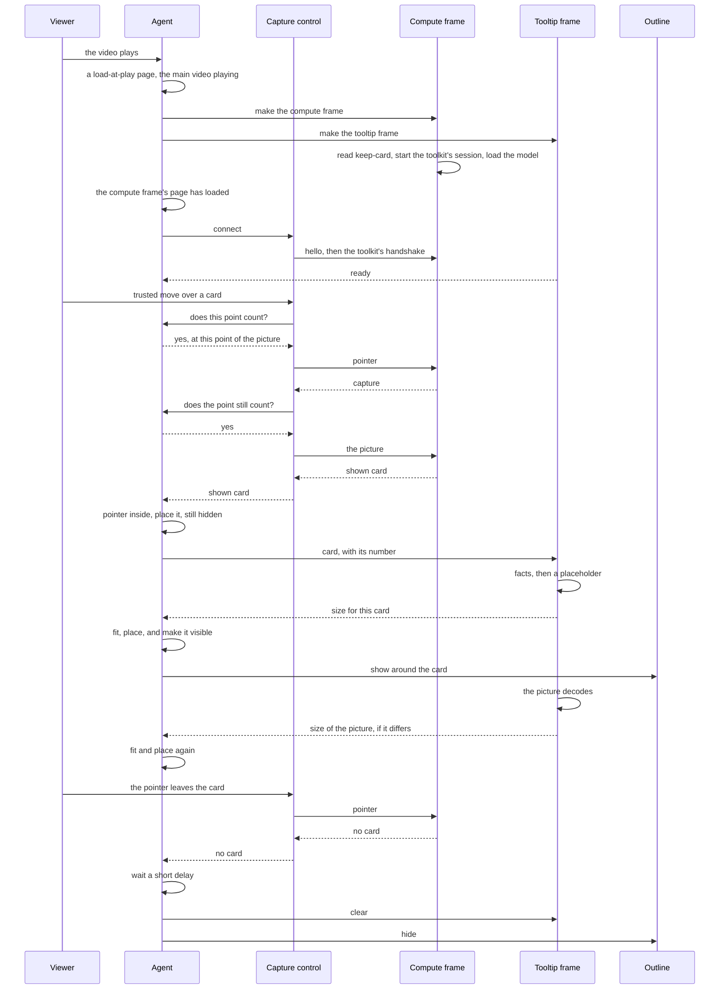

| Step | Anchors | Spec |
| --- | --- | --- |
| The video plays | `src/content/agent.ts#Agent.onPlaying`, `src/content/agent.ts#Agent.loadIfPlaying` | S-A1 |
| Both frames made | `src/content/agent.ts#Agent.ensureFrames` | S-A1, S-B8 |
| The compute frame starts | `src/compute/compute.ts`, `src/compute/frame.ts#startDuelSightFrame` | S-H2 |
| Connect when its page has loaded | `src/content/agent.ts#Agent.ensureCompute` | |
| The tooltip frame says ready | `src/tooltip/tooltip.ts`, `src/content/agent.ts#Agent.onMessage` | |
| Does the point count, at the pointer and before the capture | `src/content/agent.ts#Agent.eligibleAt` | S-B5 |
| The shown card | `src/content/agent.ts#Agent.constructor`, `src/content/agent.ts#Agent.updateTooltip` | S-W8 |
| Placed, hidden until sized | `src/content/agent.ts#Agent.showTooltip` | |
| The tooltip frame draws and sizes | `src/tooltip/controller.ts#TooltipController.show` | |
| Outline | `src/content/outline.ts#CardOutline.show` | S-F1 |
| Hidden after a delay | `src/content/agent.ts#Agent.updateTooltip`, `src/content/agent.ts#Agent.hideTooltip` | S-F1 |

### 3b. A card of a newer release

The settings name a newer card release than the one bundled, and the compute frame loaded it. The
tooltip frame's bundled table may not have the card, so the compute frame sends its facts on the
facts channel, which a web page cannot reach. A tooltip frame made again, or one that got the card
before its facts, asks on the channel, and is answered for a card that compute frame showed.

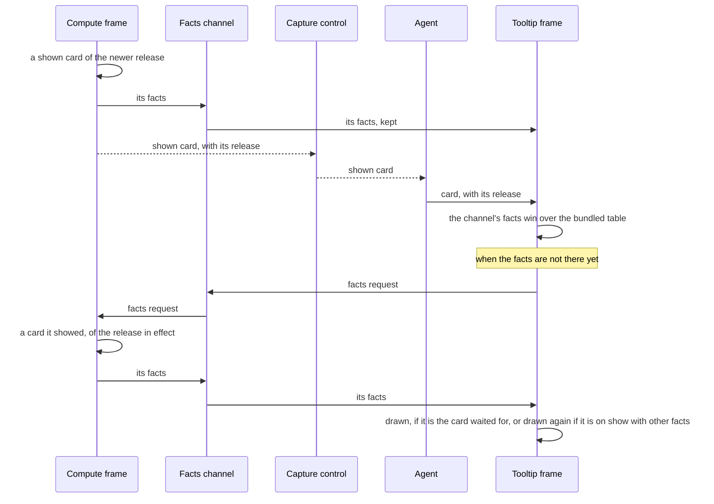

| Step | Anchors | Spec |
| --- | --- | --- |
| A shown card's facts sent | `src/compute/frame.ts#createFactsChannel`, `src/compute/frame.ts#SHOWN_IDS_LIMIT` | |
| Kept by the tooltip frame | `src/tooltip/tooltip.ts`, `src/tooltip/controller.ts#TooltipController.addFacts`, `src/tooltip/controller.ts#FACTS_LIMIT` | |
| Card with its release | `src/content/agent.ts#Agent.showTooltip`, `src/shared/messages.ts#TooltipIn` | |
| Facts looked up | `src/tooltip/controller.ts#TooltipController.lookup` | |
| A request | `src/tooltip/controller.ts#TooltipController.show`, `src/shared/messages.ts#parseFactsRequest` | |
| Answered for a shown card | `src/compute/compute.ts`, `src/compute/frame.ts#FactsChannel` | |

## Coverage

These files are the map's coverage. Each must carry at least one anchor above, and a change to one
of them updates this page in the same pull request. Not covered: the toolkit's runtime under
`vendor/` (its own map), the settings file and its checks (`src/settings/`), the details files and
the card language (`src/details/`, the tooltip frame's details sync, the popup's details and
language controls), the background's refresh rule, and the build.

- `src/compute/compute.ts`
- `src/compute/frame.ts`
- `src/compute/load-request.ts`
- `src/content/agent.ts`
- `src/content/geometry.ts`
- `src/content/index.ts`
- `src/content/outline.ts`
- `src/content/site.ts`
- `src/content/storage-sync.ts`
- `src/images/chain.ts`
- `src/popup/card-size-control.ts`
- `src/popup/switch-control.ts`
- `src/popup/view.ts`
- `src/shared/card-size.ts`
- `src/shared/enabled.ts`
- `src/shared/keep-card.ts`
- `src/shared/messages.ts`
- `src/shared/panel-layout.ts`
- `src/tooltip/controller.ts`
- `src/tooltip/frame-shape.ts`
- `src/tooltip/panel-dom.ts`
- `src/tooltip/tooltip.ts`
