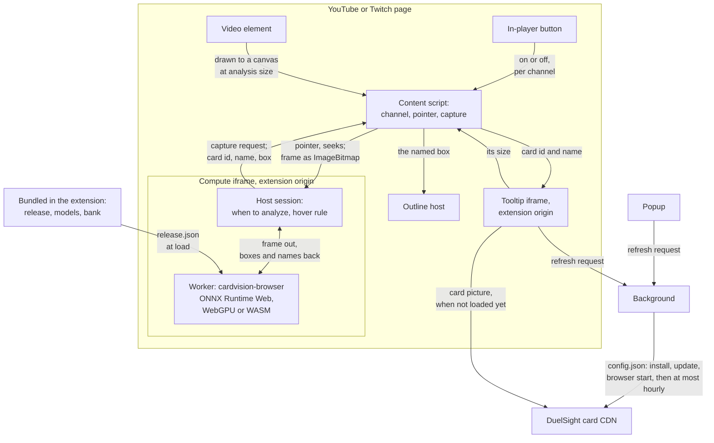

<!-- SPDX-License-Identifier: Apache-2.0 -->
# How it works

The extension's parts and the settings file that controls where card pictures come from. For building and changing it, see [development.md](development.md).

*[Back to README](../README.md)*

## Overview

The extension is built on an open-source card recognition runtime,
`cardvision-browser` (Apache-2.0; see [Built on cardvision](../README.md#built-on-cardvision)), and a
Yu-Gi-Oh! release of its models: a detector that finds cards in the picture and a
recognizer that matches each card against a bank of known cards, with an accept rule that shows
nothing when the match is not clear.

- The **content script** (`src/content/`) runs in YouTube and Twitch pages. It follows the
  page's main video and the pointer over it, and captures a picture when asked.
- A hidden **compute frame** (`src/compute/`), an extension page inside the video page, hosts
  the runtime's worker. It decides when to analyze a picture (around pointer activity,
  with the runtime's scheduler), and which card a tooltip shows at the pointer (the runtime's
  hover rule). Pictures go from the content script to this frame and nowhere else.
- The **tooltip frame** (`src/tooltip/`), an extension page placed beside the card, shows its
  picture alone (320 px wide, scaled down to fit the window but not below 200 px), or its name
  when there is no picture. It takes no pointer events.
- The **background** (`src/background/`) fetches the settings file.
- There is **no geometric stage** in this build (the runtime's extra-accuracy check with OpenCV.js
  and a large card-feature index). It is not configured, not copied into the package and not
  requested: the compute frame sends the runtime a plain load request. The vendored runtime's own
  code still contains the stage, dormant, since changing it is a toolkit matter.

## Architecture

**How to read it.** An arrow into the card CDN is a request, with its contents and its timing as
in [PRIVACY.md](../PRIVACY.md). Nothing else leaves the browser.

- **The content script** works out the page's channel from its address or channel link, and
  shows the in-player button. Until the viewer turns card hovers on for that channel, it makes
  no frame and loads no model. After that it reports the pointer and seeks to the compute frame,
  and, when asked and the pointer is active over the player, draws the video to a canvas at
  analysis size and transfers it as an `ImageBitmap`.
- **The compute frame** decides when to analyze and runs the hover rule; its worker runs the
  vendored runtime on the release bundled in the extension. Nothing in it goes to the network.
- **The tooltip frame** gets a card id and name, loads the card's picture (from the CDN, or none with `namesOnly`), and reports its size back. The
  content script places it, and draws the **outline** around the same box.
- **The background** fetches the settings file. The popup and the tooltip frame ask it for a
  refresh, which it makes at most once an hour.

## The settings file

Where pictures come from is decided by a small settings file at
`<cdnBase>/config.json` (schema version 1; `cdnBase` is the one value in `duelsight.config.json` that names the CDN host, a placeholder until the domain is decided), so that images can be switched to
another source, or off, without a new extension release:

- `namesOnly: true` shows no pictures at all: the card's name alone.
- `primary` is the project's own image server; `fallbacks` are tried in order when it fails
  (an error, a body that is not a picture, or no picture within 5 seconds); with none left, the
  tooltip shows the card's name.
- Card ids are Yu-Gi-Oh! passcodes (digits, up to 8). One card name with several artworks is one
  identity in the release's groups.
- `cardLink` and `geometric` are retired fields: a file may still carry them; they are ignored.
- The tooltip's link to Konami's official card database is built by `src/tooltip/card-link.ts` as
  an address (a card page when the catalog row has a `konamiId`, else a name search). It is
  never fetched.

The file is checked strictly. A file that cannot be used leaves the last good copy in effect, or
the copy built into the extension. An image source on a host the extension has no permission
for is ignored (adding a host needs a new release). The extension also reads an optional
`update: { "latest": "x.y.z", "url": "https://…" }` field: when the running version is lower,
the popup shows one dismissible "New version available" line. The address must be on the
project's releases page; others are ignored.
