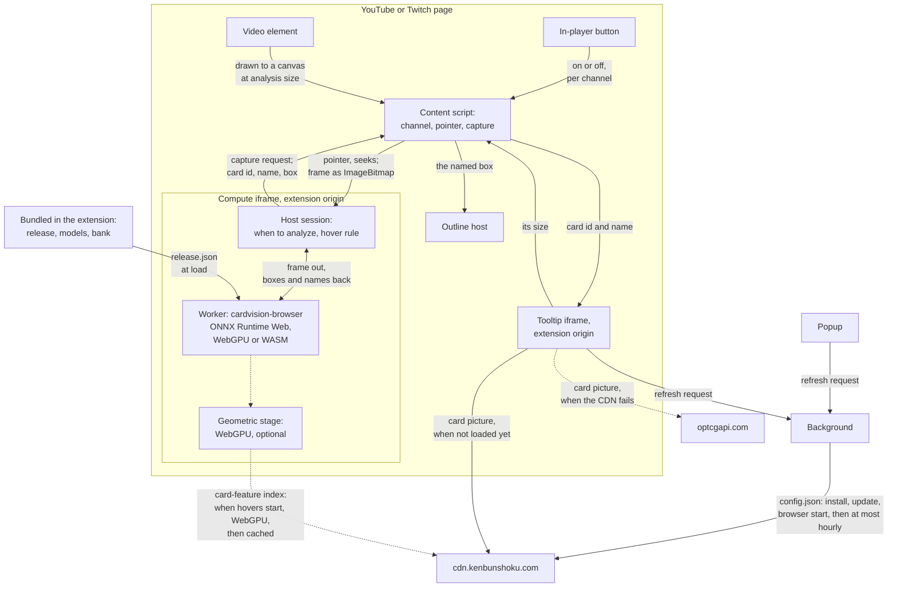

<!-- SPDX-License-Identifier: Apache-2.0 -->
# How it works

The extension's parts and the settings file that controls where card pictures come from. For building and changing it, see [development.md](development.md).

*[Back to README](../README.md)*

## Overview

The extension is built on an open-source card recognition runtime,
`cardvision-browser` (Apache-2.0; see [Built on cardvision](../README.md#built-on-cardvision)), and a One
Piece Card Game release of its models: a detector that finds cards in the picture and a
recognizer that matches each card against a bank of known cards, with an accept rule that shows
nothing when the match is not clear.

- The **content script** (`src/content/`) runs in YouTube and Twitch pages. It follows the
  page's main video and the pointer over it, and captures a picture when asked.
- A hidden **compute frame** (`src/compute/`), an extension page inside the video page, hosts
  the runtime's worker. It decides when to analyze a picture (only around pointer activity,
  with the runtime's scheduler), and which card a tooltip shows at the pointer (the runtime's
  hover rule). Pictures go from the content script to this frame only.
- The **tooltip frame** (`src/tooltip/`), an extension page placed beside the card, shows its
  picture alone (320 px wide, scaled down to fit the window but not below 200 px), or its name
  when there is no picture. It takes no pointer events.
- The **background** (`src/background/`) fetches the settings file.
- The runtime's **geometric stage** (WebGPU only) checks each recognized card against its art's
  ORB features, using OpenCV.js and a packed card-feature index on the CDN. The compute frame
  passes the bundled stage settings (`data/geometric.json`, which names the index's manifest)
  and the manifest's pinned SHA-256 (`kenbunshoku.config.json`); the worker downloads the index after
  the release has loaded, keeps it in the Cache API, checks every shard's SHA-256, and turns
  the stage off by itself when it is too slow or fails. The compute frame asks the browser to
  keep that storage (`navigator.storage.persist()`).

## Architecture

**How to read it.** Dashed arrows are the optional geometric stage and the picture fallback;
the rest is the base pipeline. An arrow into `cdn.kenbunshoku.com` or
`optcgapi.com` is a request, with its contents and its timing as in [PRIVACY.md](../PRIVACY.md).

- **The content script** works out the page's channel from its address or channel link, and
  shows the in-player button. Until the viewer turns card hovers on for that channel, it makes
  no frame and loads no model. After that it reports the pointer and seeks to the compute frame,
  and, when asked and the pointer is active over the player, draws the video to a canvas at
  analysis size and transfers it as an `ImageBitmap`.
- **The compute frame** decides when to analyze and runs the hover rule; its worker runs the
  vendored runtime on the release bundled in the extension. Nothing in it goes to the network
  except the card-feature index of the optional geometric stage, which the worker downloads
  after the release has loaded and keeps in Cache Storage.
- **The tooltip frame** gets a card id and name, loads the card's picture (from the CDN, then
  `optcgapi.com` if the CDN fails, or none with `namesOnly`), and reports its size back. The
  content script places it, and draws the **outline** around the same box.
- **The background** fetches the settings file. The popup and the tooltip frame ask it for a
  refresh, which it makes at most once an hour.

## The settings file

Where pictures come from is decided by a small settings file at
`https://cdn.kenbunshoku.com/config.json` (schema version 1), so that images can be switched to
another source, or off, without a new extension release:

- `namesOnly: true` shows no pictures at all: the card's name only.
- `geometric: false` (optional; absent means on) turns the extra-accuracy stage off: the
  card-feature file is not downloaded, from the next page a video is hovered on.
- `primary` is the project's own image server; `fallbacks` are tried in order when it fails
  (an error, a body that is not a picture, or no picture within 5 seconds); with none left, the
  tooltip shows the card's name.
- `cardLink` is obsolete: the tooltip has no link. A file may still carry it; it is ignored.

The file is checked strictly. A file that cannot be used leaves the last good copy in effect, or
the copy built into the extension. An image source on a host the extension has no permission
for is ignored (adding a host needs a new release). The extension also reads an optional
`update: { "latest": "x.y.z", "url": "https://…" }` field: when the running version is lower,
the popup shows one dismissible "New version available" line. The address must be on the
project's releases page; any other is ignored.
